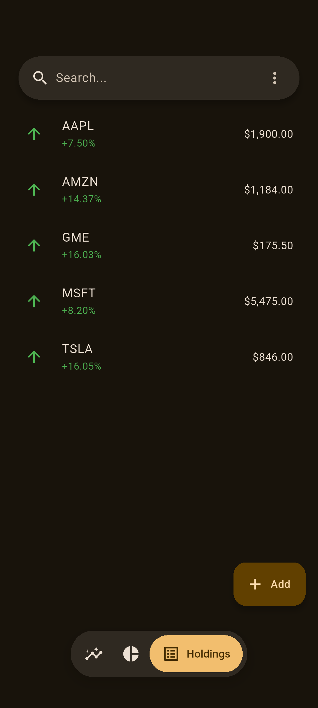
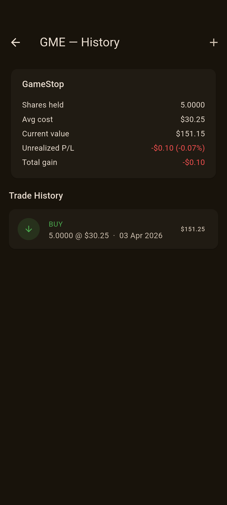
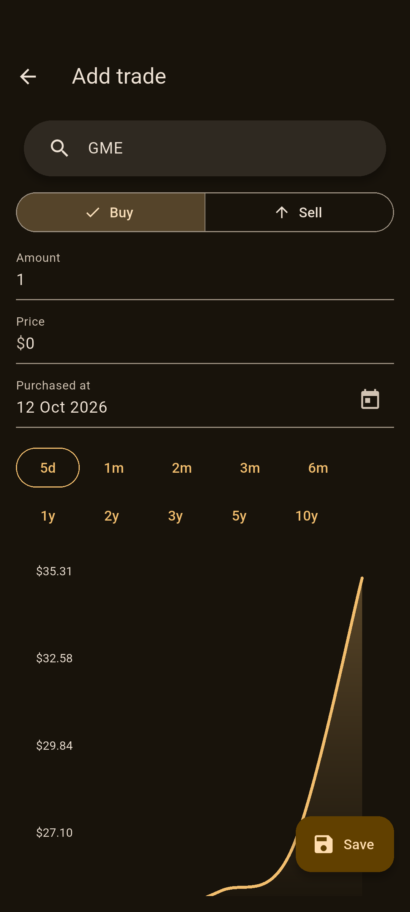
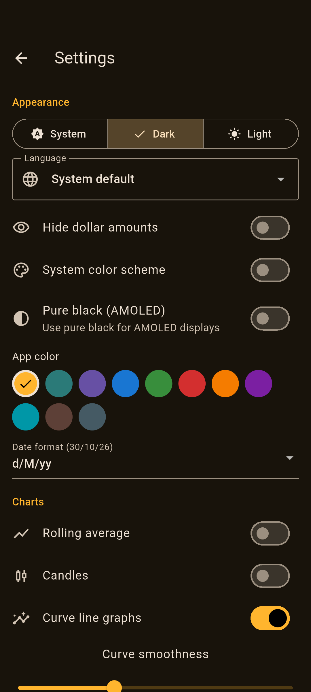
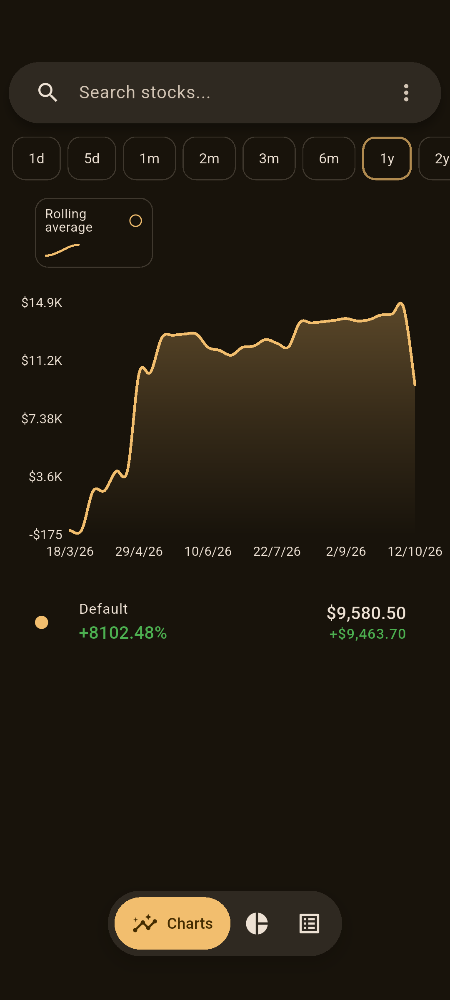
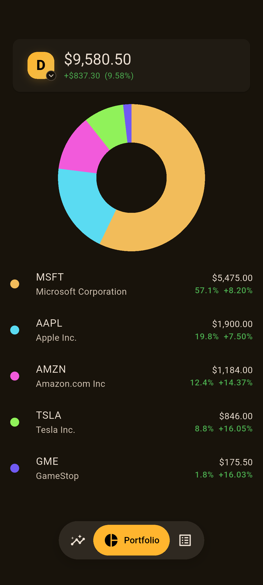

# MarketMonk

Track stocks on any platform 📈

<p float="left">
  <a href="https://github.com/brandonp2412/MarketMonk/releases/latest"></a>
    <a href="#"></a>
</p>

# Features

- 💹 Stock charts with daily and intraday Yahoo Finance data
- 🥧 Build and monitor your portfolio
- 🏦 Optional read-only Interactive Brokers live portfolio source
- ⚙️ Customize to your hearts desires

<p float="left">
<a href="https://play.google.com/store/apps/details?id=com.codesail.market_monk"></a>
<a href="https://f-droid.org/packages/com.codesail.market_monk"></a>
<a href="https://apps.microsoft.com/detail/9PP4HKV1CMWC?mode=direct"></a>
</p>

<br />
<p float="left">
    
    
    
    
    
    
</p>

# Donations

If you would like to support this project:

- Bitcoin `bc1qzlte8featxzf7xvtp3rjv7qqtwkgpup8hu85gp`
- Monero (XMR) `85tmLfWKbpd8nxQnUY878DDuFjmfcoCFXPWR7XYKLHBSbDZV8wxgoKYUtHtq1kHWJg4m14sdBXhYuUSbxEDA29d19XuREL5`
- [GitHub sponsor](https://github.com/sponsors/brandonp2412)

# Contributing

All issues and pull requests are welcome! Bugs will be fixed faster if you include reproduction steps (and maybe [logs](https://developer.android.com/tools/logcat)). Any performance related pull requests will bring tears of joy to my eye.

# Developers

Install [flutter](https://docs.flutter.dev/get-started/install) to run this app.

Use the pinned SDK: `./flutter/bin/flutter run -d linux`, or
`./scripts/run_linux.sh`. The VS Code workspace also selects `flutter/`.
`scripts/watch.sh` watches Dart sources and requests reloads only for Flutter
sessions running from this repository.

For slow reloads, run `./scripts/run_linux.sh -v` and inspect the final
`compile`, `reload`, and `reassemble` timings. Compilation and the reported
synced size help distinguish broad source invalidation from expensive widget
rebuilds. Hot reload preserves state and does not rerun startup migrations.

In a Linux investigation, a reload detecting changes to three Flutter SDK
libraries reloaded 607 libraries and synced 42.6 MB in 4,075 ms (compile:
3,006 ms, reload: 751 ms, reassemble: 293 ms). The next reload took 383 ms;
a small edit to `main.dart` took 426 ms. These samples identify broad SDK
invalidation as a source of occasional delay, but do not establish a persistent
app bottleneck or performance on other platforms. Avoid formatting the SDK
during a development session: `./flutter/bin/dart format lib test tool
integration_test` limits routine formatting to app sources. The required
completion check `./flutter/bin/dart format .` also traverses the SDK.

## Command line

Market Monk includes an installable `mm` terminal client for inspecting and editing portfolio data. See the [CLI guide](docs/cli.md) for installation, examples, safety notes, and screenshots.

## Interactive Brokers

MarketMonk can use the standalone read-only proxy in [`server/`](server/) as the current portfolio source. The recommended backend connects to the standard TWS / IB Gateway socket API; the Client Portal Web API remains available as an alternative. Current IBKR stock positions also prefer IBKR historical bars for charts. Yahoo remains the fallback for unheld symbols or when IBKR historical data is unavailable. The proxy is independent of any personal trading bot or login automation.

Stock charts offer `1d` with one-minute bars for the latest trading session and `5d` with 15-minute bars. Both IBKR backends support these ranges through `/v1/intraday`; update the self-hosted proxy to use IBKR intraday data. Older proxies automatically fall back to Yahoo. IBKR data requires the relevant market-data permissions.

Intraday charts show the provider and local device time. Pull to refresh or use the desktop refresh button to update prices; these are fetched bars, not a streaming quote subscription. Intraday responses are cached in memory for one minute and kept separate from the daily database used by portfolio charts. Longer stock ranges continue to use daily history.

## Migrations

After editing any table in `lib/tables.dart` you need to:

1. Bump `schemaVersion` in `lib/database.dart`
2. Run `dart run drift_dev make-migrations`
3. Add the relevant migration step in `lib/database.dart` `migrationSteps`.
   e.g.

```dart
from3To4: (Migrator m, Schema4 schema) async {
  await m.createTable(schema.candles);
},
```

4. Run `dart run build_runner build -d`

Portfolio and selected favorite charts offer `1d` and `5d` intraday views. Short portfolio ranges reconstruct observed stock-price movement using current holdings and exchange rates, anchored to the current account NAV, with cash and unpriced assets held constant. These estimates exclude changes in quantities, cash flows, and historical exchange rates; unavailable holdings are named in the chart. Longer IBKR account ranges continue to use daily broker NAV and returns. When comparing accounts against saved stock benchmarks, the chart uses cash-flow-adjusted IBKR returns rather than account-balance changes. Choosing a custom start date rebases the chart, account percentages, benchmark cards, and chart tooltips to that same visible period; current account balances still show the latest value.

Run the live Linux chart test with `flutter/bin/flutter test integration_test/intraday_live_test.dart -d linux`. It fetches real Yahoo bars and, when configured, both IBKR portfolio and stock bars, checks rendered point counts, and saves screenshots in `/tmp/market-monk-intraday-e2e`, using an isolated test database. To exercise deployed IBKR accounts too, pass a private `--dart-define-from-file` JSON file whose `MARKET_MONK_LIVE_CONFIGS` value is a JSON-encoded list of objects with `base_url` and `token` fields. Keep that file and the resulting test build private because they contain credentials.

Completed intraday portfolio ranges remain cached while the Charts page is alive, so switching between visited `1d` and `5d` ranges renders immediately without fetching prices again. Refresh clears these snapshots; account configuration and trade changes invalidate them. Intraday prices use a five-minute cache. Updated proxies support a portfolio batch endpoint to avoid repeated broker setup for every holding; older proxies fall back to individual requests.
