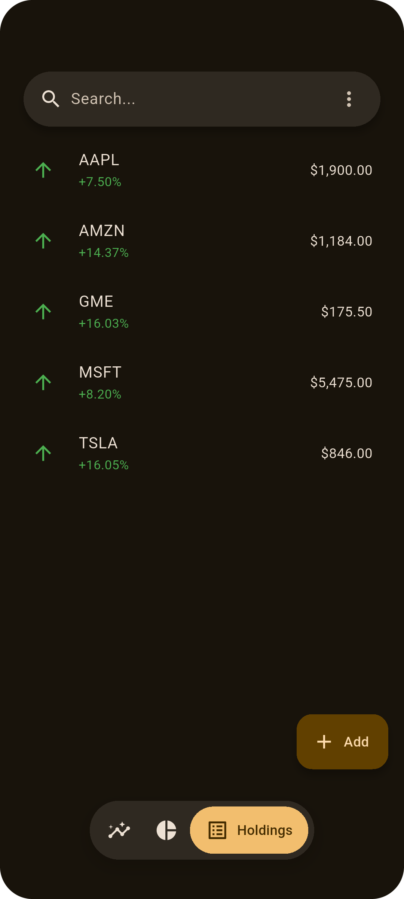
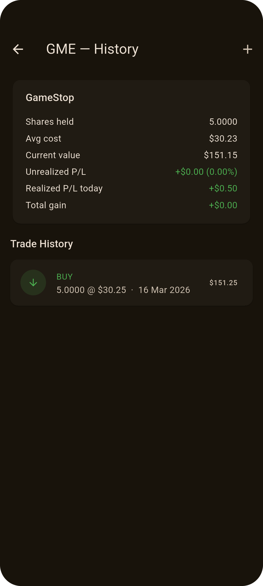
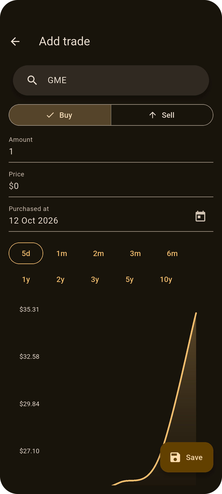
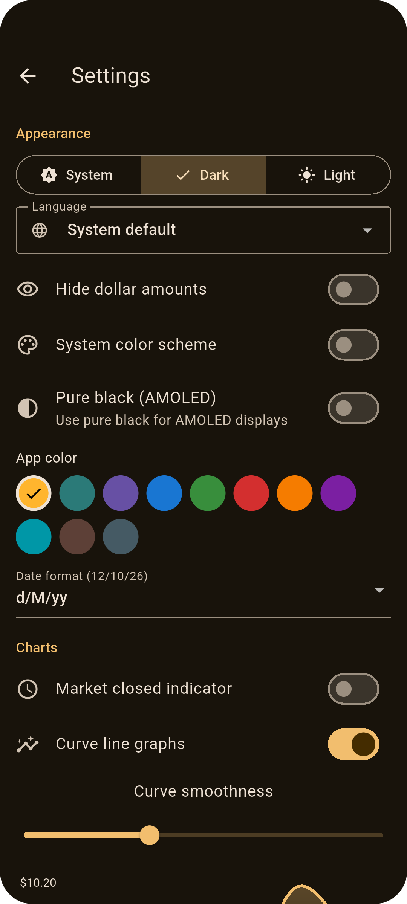
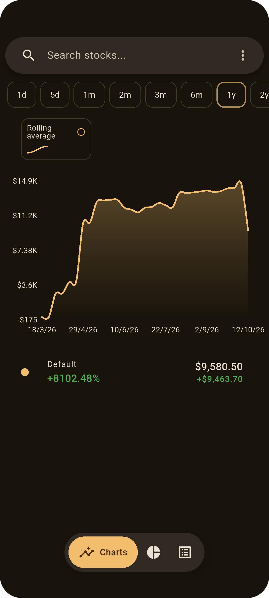
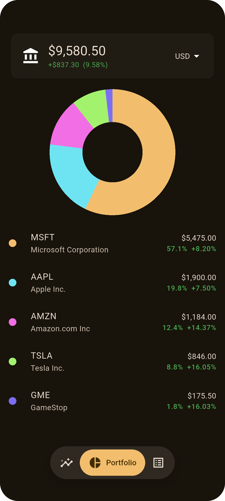

# MarketMonk

Track stocks on any platform 📈

  
  

  
  
  

# Features

- 💹 Stock charts with daily and intraday Yahoo Finance data
- 🥧 Build and monitor your portfolio
- 🏦 Optional read-only Interactive Brokers live portfolio source
- ⚙️ Customize to your hearts desires

 

    
    
    
    
    
    

# Donations

If you would like to support this project:

- Bitcoin `bc1qzlte8featxzf7xvtp3rjv7qqtwkgpup8hu85gp`
- Monero (XMR) `85tmLfWKbpd8nxQnUY878DDuFjmfcoCFXPWR7XYKLHBSbDZV8wxgoKYUtHtq1kHWJg4m14sdBXhYuUSbxEDA29d19XuREL5`
- [GitHub sponsor](https://github.com/sponsors/brandonp2412)

# Contributing

All issues and pull requests are welcome! Bugs will be fixed faster if you include reproduction steps (and maybe [logs](https://developer.android.com/tools/logcat)). Any performance related pull requests will bring tears of joy to my eye.

# Developers

Install [flutter](https://docs.flutter.dev/get-started/install) to run this app.

Use the pinned SDK: `./flutter/bin/flutter run -d linux`, or
`./scripts/run_linux.sh`. The VS Code workspace also selects `flutter/`.
`scripts/watch.sh` watches Dart sources and requests reloads only for Flutter
sessions running from this repository.

## Command line

Market Monk includes an installable `mm` terminal client for inspecting and editing portfolio data. See the [CLI guide](docs/cli.md) for installation, examples, safety notes, and screenshots.

## Interactive Brokers

MarketMonk can use the standalone read-only proxy in [`server/`](server/) as the current portfolio source.